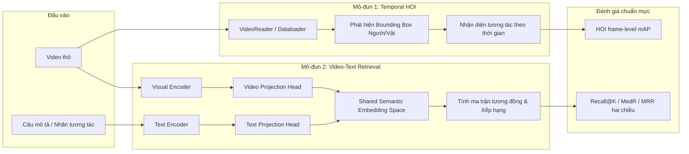

# Mô hình Thị giác – Ngôn ngữ trong Phát hiện Tương tác Người – Vật thể và Truy vấn Video – Văn bản

> Nghiên cứu Zero-shot / Open-vocabulary Human-Object Interaction (HOI) Detection và học căn chỉnh Video–Văn bản trong không gian ngữ nghĩa chung.

**Sinh viên thực hiện:** Ngô Hoàng Phú  
**Tài liệu & Báo cáo:** [PRD](docs/prd.md) · [Giao thức thực nghiệm (Protocols)](docs/protocols/) · [Báo cáo hàng tuần (Google Drive)](https://drive.google.com/drive/folders/1gzjTKl1uKl0Vh60P39wmgpQdl2FZudV1?hl=vi)

---

## 1. Phạm vi nghiên cứu

Hệ thống được thiết kế thành hai mô-đun độc lập nhưng có khả năng tương hỗ biểu diễn:

| Mô-đun | Đầu vào & Đầu ra | Mục tiêu & Đánh giá |
|---|---|---|
| **M1 — Zero-shot / Open-vocabulary HOI Detection** | Video và danh sách tương tác bằng văn bản $\to$ Hộp người, hộp vật, nhãn tương tác, điểm số (score) theo từng mốc thời gian. | Nhận diện chi tiết hành vi người–vật trong video; đánh giá bằng **frame-level HOI mAP** trên tập **VidHOI**. |
| **M2 — Video–Text Cross-modal Retrieval** | Video và câu mô tả tự nhiên $\to$ Biểu diễn trong **Shared Semantic Embedding Space**, ma trận tương đồng và xếp hạng. | Tìm kiếm video theo văn bản và ngược lại; đánh giá bằng **Recall@1/5/10, MedR, MRR** trên tập **MSR-VTT**. |

- **Mô-đun 1 (Video HOI):** Sử dụng tập nền tảng **VidHOI** (78 lớp vật thể, 50 lớp hành động). Nghiên cứu tập trung vào hướng tiếp cận tập mở (open-set/zero-shot) như ACoLP hoặc chuyển giao từ mô hình ảnh (SL-HOI), phân tách rõ giữa đánh giá với hộp chuẩn (Oracle) và hộp do mô hình tự dự đoán.
- **Mô-đun 2 (Video–Text Retrieval):** Sử dụng tập chuẩn **MSR-VTT** theo phân chia JSFusion (9.000 train / 1.000 test). Tập phát triển (8.100 train / 900 validation) gom nhóm theo URL video gốc để tránh trùng URL giữa train và validation. Cách chia này không chứng minh độc lập về cảnh quay hoặc dữ liệu pretraining; official train/test vẫn giữ nguyên nguồn và có URL chung.

---

## 2. Kiến trúc Hệ thống

Hệ thống xử lý luồng dữ liệu đa phương thức qua các tầng:



---

## 3. Cấu trúc Thư mục Kho lưu trữ

Cấu trúc các thư mục và tệp tin chính thức trên Git:

```text
configs/                                Cấu hình tham số thực nghiệm (JSON)
  ├── msrvtt_clip4clip_inference.json    Suy luận checkpoint native có xác minh nguồn
  ├── msrvtt_pooling.json               Đối chứng B0/B1/B2 từ media hoặc cache frame
  ├── pilot_video_loading.json              Cấu hình trích xuất khung hình và pilot nhẹ
  ├── msrvtt_protocol.json          Cấu hình benchmark và chia tập MSR-VTT
  ├── vidhoi_protocol.json          Cấu hình đánh giá mAP trên VidHOI
  ├── frozen_feature_alignment.json               Cấu hình head và cache đặc trưng đóng băng
  ├── hoi_union_crop.json                       Gate nguồn detector và union crop
  ├── global_local_comparison.json             Hợp đồng so sánh cùng điều kiện
  └── cache_cost_experiment.json               Thí nghiệm chi phí cache có đối chứng
docs/                                   Tài liệu phân tích và đặc tả kỹ thuật
  ├── prd.md                            Tài liệu yêu cầu sản phẩm và nghiên cứu (PRD)
  └── protocols/                        Đặc tả giao thức thực nghiệm
      ├── retrieval_metric_conformance.md     Đối chuẩn độ đo với CLIP4Clip
      ├── msrvtt_protocol.md                 Giao thức chia tập MSR-VTT chống rò rỉ dữ liệu
      ├── vidhoi_protocol.md                 Giao thức đánh giá frame mAP trên VidHOI
      ├── msrvtt_adapter_evaluation.md  Adapter metadata, coverage và score artifact
      ├── vidhoi_adapter_evaluator.md   Schema annotation/result và evaluator ST-HOI
      ├── vidhoi_static_probe.md        Suy luận CLIP với hộp chuẩn trên mẫu train
      ├── vidhoi_representation_diagnostic.md  Đối chứng toàn ảnh, vật thể và vùng cặp
      ├── vidhoi_head_development.md    Học head trên cache và development tách video
      ├── vidhoi_pair_diagnostics.md    Chẩn đoán theo cặp và kiểm nhãn actor
      ├── pilot_baseline.md             Global mean OpenCLIP và kiểm chứng artifact
      ├── alignment_training.md         Cache, multi-positive loss và checkpoint
      ├── retrieval_pooling.md          Giao thức và cách chạy B0/B1/B2
      └── retrieval_bottleneck.md       Đo chi phí và đối chứng global/union
scripts/                                Kịch bản tiện ích thực thi
  ├── kaggle/msrvtt/                    Mã B0–B3 có SHA256 và notebook Kaggle công khai
  ├── check_environment.py              Kiểm tra môi trường máy (PyTorch, CPU/GPU, OS)
  ├── download_samples.py               Tải video mẫu về máy cục bộ
  ├── prepare_lightweight_pilot.py       Khởi tạo dữ liệu nhãn mẫu
  ├── smoke_test.py                     Chạy thử nghiệm luồng trích xuất video–text với OpenCLIP
  ├── lock_msrvtt_protocol.py           Thuật toán phân chia dữ liệu MSR-VTT
  ├── compare_benchmark_metrics.py      Đối chiếu các hàm đo lường với CLIP4Clip
  ├── evaluate_msrvtt.py                Audit metadata hoặc chấm score/embedding có ID
  ├── evaluate_vidhoi.py                Chấm ST-HOI results hoặc đối chuẩn notebook
  ├── run_pilot_baseline.py             Chạy global mean hoặc union crop có nguồn hộp
  ├── lock_vidhoi_protocol.py           Khóa annotation, frame mask và triplet support
  ├── profile_pipeline.py              Đo lại từng pha decode/encoder/evaluator
  ├── extract_pair_boxes.py            Chuyển predictions detector đã xác minh thành pair
  ├── compare_global_local.py           Kiểm điều kiện đối chứng và chênh lệch score
  ├── cache_msrvtt_features.py           Cache frame/caption theo shard có hash
  ├── run_msrvtt_baseline.py             Suy luận CLIP4Clip meanP từ checkpoint local
  ├── run_msrvtt_pooling.py              Chạy B0/B1/B2 và kiểm baseline trước đối chứng
  ├── run_vidhoi_static.py               Suy luận HOI tĩnh với CLIP và hộp/lớp chuẩn
  ├── prepare_vidhoi_kaggle.py           Đóng gói source, frame, weights và notebook
  ├── run_vidhoi_diagnostics.py          So ba cách lấy vùng ảnh trên cùng cặp oracle
  ├── prepare_vidhoi_diagnostics_kaggle.py  Đóng gói notebook đối chứng ba vùng ảnh
  ├── run_vidhoi_head_study.py           Cache, học và kiểm chứng head M1 theo stage
  ├── prepare_vidhoi_head_kaggle.py      Đóng gói dữ liệu train/dev và notebook học head
  ├── run_vidhoi_pair_diagnostics.py     Chấm initial/last và review cặp người–vật
  ├── prepare_vidhoi_pair_diagnostics_kaggle.py  Đóng gói cache và dữ liệu review
  └── train_alignment.py                Học head, probe, chọn checkpoint và resume
src/temporal_hoi/                       Mã nguồn thuật toán cốt lõi
  ├── data/                             Bộ nạp video và xử lý tập dữ liệu
  │   ├── dataset.py                    Lớp TemporalHOIDataset
  │   ├── video_reader.py               Lớp VideoReader giải mã khung hình
  │   ├── msrvtt.py                     Adapter split/caption/pool có kiểm tra hash
  │   ├── vidhoi.py                     Adapter annotation, hộp, track và frame mask
  │   ├── hoi_head_cache.py              Cache vùng vật/cặp, nhãn positive và role
  │   ├── hoi_pair_review.py             Chọn case train và kiểm nhãn có provenance
  │   ├── vidhoi_lock.py                Kiểm annotation/manifest/mask và support
  │   └── pair_crops.py                 Union crop theo tọa độ pixel gốc
  ├── models/                           Head ánh xạ video/text và L2
  │   ├── alignment.py                  Projection tuyến tính khởi tạo identity
  │   └── hoi_head.py                   Residual head M1 và positive-only anchor loss
  ├── training/                         Học trên feature backbone đóng băng
  │   ├── alignment.py                  Optimizer, validation và checkpoint
  │   ├── features.py                   Xác minh shard, caption và split hashes
  │   ├── losses.py                     Contrastive hai chiều, nhiều positive
  │   ├── hoi_head_study.py              Ba head M1, ba seed và checkpoint development
  │   └── resources.py                  Trần RAM và thời gian thực đo
  ├── inference/                        Suy luận encoder và đối chứng pooling
  │   ├── clip4clip.py                  Nạp nguồn/checkpoint native đã kiểm hash
  │   ├── retrieval_pooling.py          B0 mean, B1 theo truy vấn, B2 trộn điểm
  │   ├── hoi_static.py                 Oracle train probe với CLIP đóng băng
  │   ├── hoi_diagnostics.py            Đối chứng vùng ảnh, thứ hạng nhãn và đối xứng cặp
  │   ├── hoi_kaggle.py                 Xác minh gói, dependency offline và log
  │   └── pooling_workflow.py           Cache frame, provenance và điều phối đánh giá
  └── evaluation/                       Bộ công cụ tính toán độ đo
      ├── reference/                    Evaluator CLIP4Clip đã khóa và MIT license
      ├── metrics.py                    Recall@K, MedR, MRR hai chiều, tIoU, ghép sự kiện
      ├── hoi.py                        Frame-level mAP tương thích ST-HOI
      ├── hoi_head_audit.py              AP theo nhóm development từ một evaluator
      ├── hoi_pair_diagnostics.py        Trace top100/matching từ checkpoint cố định
      ├── profiling.py                  Đồng hồ từng pha và nhóm lỗi retrieval
      └── global_local.py               Kiểm cohort, head và các yếu tố giữ cố định
tests/                                  Bộ kiểm thử tự động (Unit tests chạy với pytest)
  ├── test_benchmark_metrics.py         Kiểm thử đối chuẩn bộ đo với mã nguồn tác giả
  ├── test_data.py                      Kiểm thử VideoReader và TemporalHOIDataset
  ├── test_metrics.py                   Kiểm thử các hàm đo lường toán học
  ├── test_msrvtt_protocol.py           Kiểm thử logic phân chia dữ liệu MSR-VTT
  ├── test_retrieval.py                 Kiểm thử tìm kiếm video–văn bản hai chiều
  ├── test_msrvtt_adapter.py            Kiểm thử ID/caption/coverage và masked meanP
  ├── test_vidhoi.py                    Kiểm thử schema, track, transform và frame mask
  ├── test_vidhoi_cli.py                Kiểm thử provenance và điều kiện chấm results
  ├── test_hoi_metrics.py               Kiểm thử matching, top-k và VOC AP
  ├── test_hoi_static.py                Kiểm proposal, score, input và checkpoint an toàn
  ├── test_vidhoi_kaggle.py             Kiểm gói, dependency offline và sáu cell notebook
  ├── test_hoi_diagnostics.py           Kiểm crop, union parity và nhãn chưa biết
  ├── test_vidhoi_diagnostics_kaggle.py  Kiểm gói ba nhánh và điều kiện xuất kết quả
  ├── test_hoi_head_cache.py            Kiểm cache, nhãn unknown và held-out leakage
  ├── test_hoi_head_study.py            Kiểm loss, cập nhật head và chọn epoch
  ├── test_hoi_head_audit.py            Kiểm phân nhóm AP trên cùng evaluator
  ├── test_hoi_head_cli.py              Kiểm cấu hình replay và sai khác AP
  ├── test_vidhoi_head_kaggle.py        Kiểm gói học head và replay checkpoint
  ├── test_hoi_pair_diagnostics.py      Kiểm trace, checkpoint, hash và source ZIP
  ├── test_hoi_pair_review.py           Kiểm unknown, nhãn người xem và HTML offline
  ├── test_vidhoi_pair_diagnostics_cli.py  Kiểm nhãn bổ sung và phép so sánh actor
  ├── test_vidhoi_pair_diagnostics_kaggle.py  Kiểm notebook và điều kiện xuất review
  ├── test_vidhoi_pair_transport.py      Kiểm ZIP lồng, byte nguồn và input đã giải nén
  ├── test_pilot_baseline.py            Kiểm thử pooling/relevance và candidate coverage
  ├── test_vidhoi_lock.py               Kiểm khóa input và transform tường minh
  ├── test_profile_pipeline.py           Kiểm replay, clocks và điều kiện so sánh
  ├── test_pair_crops.py                 Kiểm hộp, inverse resize và provenance
  ├── test_global_local.py               Kiểm cohort và các yếu tố giữ cố định
  ├── test_alignment_training.py         Kiểm loss, cache, gradient, resume và leakage
  ├── test_retrieval_pooling.py          Kiểm công thức, mask, hòa điểm và bootstrap
  └── test_msrvtt_pooling_cli.py         Kiểm cache, hash, baseline gate và lệnh chạy
.gitattributes                          Giữ nguyên byte snapshot mã nguồn có SHA256
.gitignore                              Quy tắc loại trừ dữ liệu, kết quả chạy và kế hoạch cá nhân
pyproject.toml, uv.lock                 Cấu hình môi trường và quản lý gói phụ thuộc (uv)
README.md                               Tài liệu giới thiệu dự án (Project Landing Page)
```

---

## 4. Cài đặt và Bắt đầu nhanh (Quickstart)

Dự án sử dụng Python 3.12 và công cụ quản lý gói `uv`.

### 4.1. Thiết lập môi trường
```powershell
# Đồng bộ môi trường và các gói phát triển
uv sync --locked --group dev

# Kiểm tra tương thích phần cứng và môi trường
uv run --frozen python scripts/check_environment.py
```

### 4.2. Chạy bộ kiểm thử tự động (Unit Tests)
```powershell
# Dùng UTF-8 cho đường dẫn và nội dung tiếng Việt trên Windows
$env:PYTHONUTF8 = "1"
# Chạy bộ kiểm thử tự động
uv run --frozen pytest
```

### Mã thực nghiệm trên Kaggle

Mã B0–B3 và notebook cho pooling, học head, đánh giá từ cache nằm trong
[`scripts/kaggle/msrvtt/`](scripts/kaggle/msrvtt/). Xem
[nguồn mã và hướng dẫn chạy](docs/protocols/kaggle_research_sources.md) để kiểm
SHA256, chuẩn bị input riêng và phân biệt mã đã lưu với notebook công khai đã
được thích nghi. Repository không phân phối dataset, checkpoint hay output phiên.

### 4.3. Tải dữ liệu mẫu và chạy Smoke Test
```powershell
# Tải video mẫu nhẹ
uv run --frozen python scripts/download_samples.py

# Khởi tạo nhãn mẫu nếu bắt đầu từ đầu
uv run --frozen python scripts/prepare_lightweight_pilot.py

# Chạy thử nghiệm luồng trích xuất đặc trưng video–text mẫu với OpenCLIP
uv run --frozen python scripts/smoke_test.py
```

### 4.4. Adapter benchmark và baseline toàn khung hình

MSR-VTT cần archive metadata từ repository tác giả và lock được tạo bởi
`lock_msrvtt_protocol.py`. Có thể truyền đường dẫn riêng qua `--archive` và `--lock`.
Lệnh audit xác minh metadata, ghi độ phủ file video và tạo JSON truy vấn cho InternVideo;
chấm score/embedding cần thêm artifact ID và provenance như hướng dẫn trong protocol.

```powershell
uv run --frozen python scripts/evaluate_msrvtt.py --help
uv run --frozen python scripts/evaluate_vidhoi.py --help
uv run --frozen python scripts/run_pilot_baseline.py --checkpoint "<checkpoint.safetensors>"
```

VidHOI cần mapping, frame manifest, mask và nguồn hộp được xác minh. Evaluator chấm
predictions được cung cấp; inference mô hình là một bước riêng. Global mean OpenCLIP
dùng checkpoint cục bộ đã chỉ định và ghi config, embedding, xếp hạng cùng chi phí chạy.

### 4.5. Học head từ cache đặc trưng

Encoder đóng băng tạo cache frame và caption theo shard. Hai head tuyến tính được
học bằng loss contrastive nhiều positive hai chiều; checkpoint được chọn trên
validation tách theo nguồn video. Cache và weights phải đúng hash trong cấu hình.

```powershell
uv run --frozen python scripts/cache_msrvtt_features.py --help
uv run --frozen python scripts/train_alignment.py --help
uv run --frozen python scripts/train_alignment.py --config configs/frozen_feature_alignment.json --readiness-only
```

[Giao thức học alignment](docs/protocols/alignment_training.md) mô tả cache,
ngân sách, probe tổng hợp, validation và resume. Công cụ báo thiếu đầu vào trước
khi học; probe chỉ kiểm tra đường cập nhật tham số.

### 4.6. Chạy baseline B0 và đối chứng B1 B2

Luồng M2 dùng encoder đóng băng và cùng dữ liệu đầu vào: B0 lấy trung bình đặc
trưng frame, B1 gom theo câu truy vấn, B2 trộn điểm B0/B1. Có thể tạo cache frame
từ video/checkpoint native cục bộ hoặc đọc lại cache đúng SHA256. Chương trình
kiểm B0 với reference trước khi chạy B1/B2, lưu metric hai chiều và provenance.

```powershell
uv run --frozen python scripts/run_msrvtt_pooling.py --help
uv run --frozen python scripts/run_msrvtt_pooling.py --config configs/msrvtt_pooling.json --output-dir outputs/pooling_preflight
```

Điền các đường dẫn và hash còn trống vào bản config local trước khi chạy thật.
[Hướng dẫn B0/B1/B2](docs/protocols/retrieval_pooling.md) mô tả chế độ tạo cache,
tính lại từ cache, điều kiện đánh giá test và cách giữ dữ liệu/trọng số ngoài Git.
Luồng này tách biệt với đối chứng toàn khung/vùng người–vật và head có học.

### 4.7. Probe HOI tĩnh trên train VidHOI

Luồng này dùng CLIP gốc đóng băng để chấm mọi predicate cho các cặp người–vật
từ hộp và lớp vật thể chuẩn. Manifest phải ghi frame, tọa độ, nguồn và hash.
Runner xuất prediction, metric trên mẫu train và preview; builder tạo gói
Kaggle chỉ từ các đầu vào local được chỉ định, không upload hoặc tải thay dữ liệu.

```powershell
uv run --frozen python scripts/run_vidhoi_static.py --help
uv run --frozen python scripts/prepare_vidhoi_kaggle.py --help
```

[Giao thức probe và gói Kaggle](docs/protocols/vidhoi_static_probe.md) mô tả
schema, checkpoint và cách chạy. Đây là probe oracle trên train, chưa thay
benchmark VidHOI đầy đủ, đánh giá zero-shot hoặc detector với hộp dự đoán.

Đường [đối chứng biểu diễn](docs/protocols/vidhoi_representation_diagnostic.md)
so toàn frame, crop vật thể và crop hợp người–vật trên cùng manifest, cặp,
checkpoint, prompt và evaluator. Một lần nạp CLIP và cache văn bản dùng chung;
chi phí mã hóa ảnh được ghi riêng cho từng cách biểu diễn. Kết quả gồm mAP,
thứ hạng nhãn positive đã biết và chẩn đoán đối xứng cặp; không xem các nhãn
chưa gán là negative hoặc dùng mẫu train đã xem để tuyên bố tổng quát hóa.

```powershell
uv run --frozen python scripts/run_vidhoi_diagnostics.py --help
uv run --frozen python scripts/prepare_vidhoi_diagnostics_kaggle.py --help
```

Đường [học head M1 trên feature đóng băng](docs/protocols/vidhoi_head_development.md)
tách train/development theo video, cache vùng vật và vùng cặp, rồi so ba head
object/union/fusion với cùng dung lượng và ba seed. Loss dùng các nhãn positive
đã quan sát cùng feature anchor; nhãn thiếu giữ là unknown. Epoch 0 được giữ
trong chọn checkpoint, kết quả từng seed và các nhóm development được báo riêng.
Notebook chạy theo stage và kiểm lại prediction từ checkpoint trước xuất ZIP.
Đây là công cụ phát triển nội bộ với hộp/lớp chuẩn; đánh giá cuối và đối chứng
chuyển feature sang retrieval M2 cần thí nghiệm riêng.

```powershell
uv run --frozen python scripts/run_vidhoi_head_study.py --help
uv run --frozen python scripts/prepare_vidhoi_head_kaggle.py --help
```

[Chẩn đoán theo cặp](docs/protocols/vidhoi_pair_diagnostics.md) dùng lại cache và
checkpoint để so initial/last, truy vết top100 và shared matching. Bộ review
train chọn không dùng model score, hiển thị ảnh/ngữ cảnh theo track và xuất
nhãn có provenance. Unknown giữ nguyên; chỉ các đối chứng positive/negative
được người kiểm tra xác nhận mới có margin/win/tie diagnostic. Công cụ không
học lại mô hình, không chạy encoder và không thay annotation benchmark.

```powershell
uv run --frozen python scripts/run_vidhoi_pair_diagnostics.py --help
uv run --frozen python scripts/prepare_vidhoi_pair_diagnostics_kaggle.py --help
```

---

## 5. Ví dụ sử dụng API

### Đọc dữ liệu video
```python
from temporal_hoi.data import TemporalHOIDataset

dataset = TemporalHOIDataset(
    split="dev",
    clips_csv="data/manifests/clips.csv",
    texts_csv="data/manifests/texts.csv",
    splits_csv="data/manifests/splits.csv",
    relevance_csv="data/manifests/relevance.csv",
    num_frames=8,
    max_frame_side=320,
)
sample = dataset[0]
print("Clip ID:", sample["clip_id"], "| Frames:", len(sample["pil_frames"]))
```

### Đánh giá tìm kiếm hai chiều (Bidirectional Retrieval)
```python
import numpy as np
from temporal_hoi.evaluation import compute_bidirectional_retrieval

# Ma trận điểm số tương đồng giữa video và text [num_videos, num_texts]
similarity_scores = np.random.rand(10, 10)
# Danh sách positive index cho từng query
video_to_text_positives = [[i] for i in range(10)]
text_to_video_positives = [[i] for i in range(10)]

results = compute_bidirectional_retrieval(
    video_text_similarity=similarity_scores,
    video_to_text_positives=video_to_text_positives,
    text_to_video_positives=text_to_video_positives,
)
print("Text-to-Video R@1:", results["text_to_video"]["R@1"])
print("Video-to-Text R@1:", results["video_to_text"]["R@1"])
```
